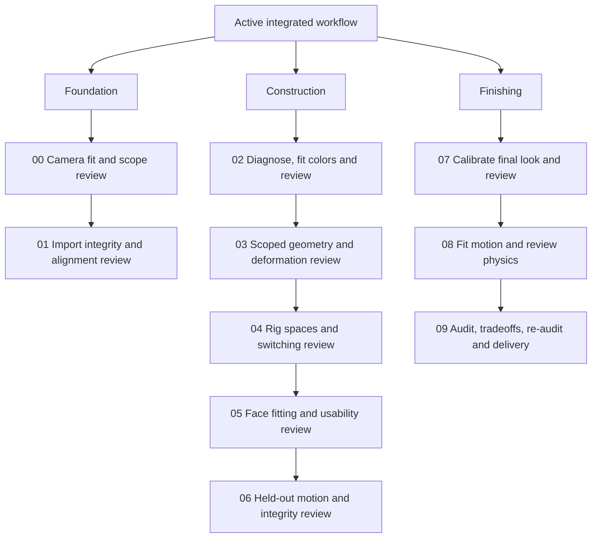
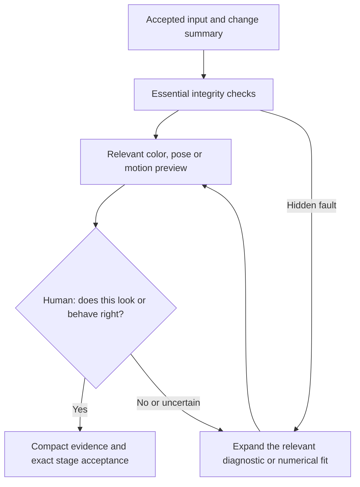

# Workflow comparison — lightweight Cycles workflow applied

**Map A preserves the version-2 workflow for comparison. Map B is now the active version-3 workflow, approved by the user.** All ten stages and their handoffs remain. Stage 09 now has two decisions; final delivery also accepts the stage. Production rendering, comparisons, animation previews and timing use Cycles only unless the user explicitly requests another engine.

## Map A — before simplification (historical version 2)

Numbers give execution order. These branches group the hierarchy; they do not authorize parallel Blender writers.

### Shared hierarchy within each stage

1. Resolve current procedure and immutable accepted input.
2. Verify input/version/ownership facts.
3. Diagnose the observed fault; preserve correct systems.
4. When fitting is relevant:
   - Freeze fixture, mask/correspondence and protected attributes.
   - Declare parameter bounds, objective, method and finite evaluation budget.
   - Run stage-local fitting/measurements, keeping uncertainty visible.
   - Stop and restore the best draft after two non-improving experiments.
5. Collect the stage evidence and affected regressions.
6. Register the exact saved candidate and required assets.
7. Record each frozen-policy required check; submit only when passing.
8. Present matched views/clips and differences at the existing human gate.
9. Accept exact human selection or record critique; changed revisions invalidate affected evidence.

### Exact stage hierarchy and mathematical additions

#### anime-blender-00-setup

- 1. Establish evidence and identity
- 2. Calibrate comparison conditions
- 3. Specify a practical pilot
- Evidence
- Apply mathematical support
- Required evidence: `source-inventory`, `environment-lock`, `reference-and-scope`, `capability-spec`.
- Exact candidate human gate: G00.

#### anime-blender-01-import

- 1. Preserve the import that works
- 2. Build correspondence
- 3. Attribute losses accurately
- Evidence
- Apply mathematical support
- Required evidence: `import-inventory`, `feature-loss-report`, `texture-dependencies`, `baseline-integrity`.
- Exact candidate human gate: G01.

#### anime-blender-02-materials

- 1. Separate restoration from reconstruction
- 2. Inventory maps before connecting them
- 3. Run the diagnostic ladder in order
- 4. Interpret color, alpha and normals explicitly
- 5. Choose a Cycles method with stated limits
- 6. Validate before expansion
- Evidence
- Apply mathematical support
- Required evidence: `material-mapping`, `cycles-comparisons`, `preview-behavior`, `material-flag-report`.
- Exact candidate human gate: G02.

#### anime-blender-03-geometry

- 1. Diagnose without cleanup
- 2. Repair the correct cause
- 3. Handle artistic changes as individual proposals
- Evidence
- Apply mathematical support
- Required evidence: `geometry-change-comparisons`, `morph-integrity`, `deformation-tests`, `correspondence-map`.
- Exact candidate human gate: G03.

#### anime-blender-04-rig

- 1. Preserve the proven deform skeleton
- 2. Solve spaces mathematically
- 3. Build and prove the interface
- Evidence
- Apply mathematical support
- Required evidence: `control-capabilities`, `rig-integrity`, `switching-demonstrations`, `runtime-dependencies`.
- Exact candidate human gate: G04.

#### anime-blender-05-ready

- 1. Preserve the expression vocabulary
- 2. Make animation usable
- Evidence
- Apply mathematical support
- Required evidence: `face-and-visemes`, `animation-usability`, `retarget-profiles`, `animator-guide`.
- Exact candidate human gate: G05.

#### anime-blender-06-tests

- 1. Test without secretly repairing
- 2. Measure the evaluated result
- 3. Repeat with a clean runtime
- Evidence
- Apply mathematical support
- Required evidence: `motion-fixtures`, `deformation-review`, `integrity-lint`, `clean-core-rig`.
- Exact candidate human gate: G06.

#### anime-blender-07-look

- 1. Calibrate the reference before the shader
- 2. Tune the smallest supported parameter
- 3. Store the accepted look
- Evidence
- Apply mathematical support
- Required evidence: `final-style-spec`, `cycles-look-comparisons`, `lighting-and-motion`, `preview-limitations`.
- Exact candidate human gate: G07.

#### anime-blender-08-physics

- 1. Start with one physical structure
- 2. Build one-way evaluation
- 3. Tune from dynamics and failures
- 4. Implement honest independent category controls
- Evidence
- Apply mathematical support
- Required evidence: `physics-part-map`, `cold-motion-tests`, `category-toggles`, `editable-unbaked`, `physics-settings`.
- Exact candidate human gate: G08.

#### anime-blender-09-audit

- 1. Audit before optimizing (09A)
- 2. Measure the intended machine and workload
- 3. Optimize measured cost only (09B), then re-audit (09C)
- 4. Test the actual package (09D)
- Evidence
- Apply mathematical support
- Required evidence: `final-quality`, `physics-off-fps`, `cold-physics-fps`, `frame-time-and-memory`, `regression-tests`, `relocated-clean-open`, `dependency-disposition`, `delivery-guide-and-recipe`.
- Exact candidate human gate: G09.

### Implemented and specified mathematics

| Coverage | Status |
| --- | --- |
| CIEDE2000, declared display-sRGB/Lab conversion, summaries, SVD rigid alignment, quaternion distance | Implemented numerical helper; utility-tested |
| Camera/IK optimization, ARAP, pose-space deformation, preference optimization, inverse simulation | Stage procedures with formulas/assumptions and primary references; no bundled live Blender solver |
| LPIPS or external differentiable renderer | Optional external method; results require actual execution and Cycles verification |
| Provisional color target | Delta E 00 <3, proposed per-region p95; human calibrates conditions, masks and statistic; maximum/tail still shown |

## Map B — applied lightweight Cycles hierarchy (version 3)

The same ten stage skills and handoffs remain. Routine work uses short Cycles demonstrations and human critique, with focused diagnostics/fitting for observed or uncertain faults. This path is applied in the skills, shared contract, policy and CLI.

### Active stage loop

When a required numeric/color condition fails, the gate must show it. Human may request a correction or explicitly amend the scope/tolerance; it cannot be relabeled a numerical pass. Reuse prior evidence only with matching dependency/fixture identities and an explicit unaffected-system rationale. Changed candidate files still need the existing ledger identity and relevant updated checks.

## Applied reductions derived from Map A

| Map A location | Applied reduction | Keep |
| --- | --- | --- |
| Repeated preflight in every stage | Keep one environment/source record; re-probe only changed facts and verify identity | Source/input identity, pinned version and stale-input detection |
| 00 camera calibration repeated during look work | Human confirms camera once; revisit only if references/camera/pose change | Matched comparison conditions and explicit ambiguity |
| 02 detailed diagnostics plus 07 look tuning | In 07 reuse accepted material-role/color baseline; rerun only affected regional checks | Delta E measurement and small critical-region review; full diagnosis for a new fault |
| 03 prospective repairs | If no geometry change is needed, use a no-change integrity report and the existing gate | Morph/UV/normal correspondence and evidence for actual edits |
| 04/05/06/09 overlapping animation demos | Maintain one versioned motion/face fixture suite; collect local smoke tests in 04/05 and full qualification in 06; rerun affected cases later | Actual switch, reset, binding, invalid-driver and clean-runtime checks |
| Per-parameter artistic analysis or preference model | Default to a compact side-by-side and human critique; invoke preference optimization only for difficult repeated search | Distinct candidate identity, bounded trials and protected accepted features |
| 08 exhaustive parameter searching for motion feel | Use a short settle/turn/landing demo with human critique before expensive inverse fitting | Cold reset, penetration/stretch, real solver suspension and manual fallback |
| 09 four internal reviews plus final stage acceptance | Combined audit+optimization disposition into one decision and reaudit+delivery+stage acceptance into one exact final decision | Actual audit, re-audit after changes, target-machine measurement and relocated clean open |
| Large repeated evidence prose | Generate one compact stage report referencing the common recipe/fixtures and listing changes/failures | Evidence bindings, known limitations and actual human decision |

## Review boundaries

A visual gate can replace redundant artistic deliberation or repeated aesthetic scoring. It cannot prove hidden dependencies, stable native simulation, correct correspondence, safe evaluation order, clean-open portability or actual UI FPS. Those need the relevant executable tests. Do not remove the Delta E check that helped the user; use human review to interpret local differences and stop needless tuning once the accepted target is met.

The simplifications are applied as version 3. The contract, frozen policy template, CLI, tests and stage procedures agree: audit then delivery. review --gate delivery validates the current submitted bundle and approves stage 09 atomically. The old optimization/reaudit gate commands are rejected. Historical version 1/2 runs retain their original tools/policy/approvals; do not rewrite them or copy their approvals. Reuse a good import as source with explicit lineage and fresh affected review rather than needlessly reimporting.

## Validation

- All eleven installed skill validators pass; local Markdown links resolve.
- Combined pure-Python suite: 51 passing tests. CIEDE2000 includes 20 published reference cases.
- Independent scenario check rejected a misleading global Delta E average, raw linear EXR input, unknown lighting and reflected import alignment.
- No Blender executable or actual character was available. Solvers described as procedures were not run, and model fidelity/hardware performance remain unqualified.

## Applied Cycles-only scope

- Use scene.render.engine='CYCLES' and 3D viewport shading.type='RENDERED' with the actual scene materials/lights/world.
- Build no alternate-engine graph, Eevee preview or external-renderer fitting path unless explicitly requested. Solid/wireframe diagnosis is not appearance/timing evidence.
- Keep the regional Delta E 00 <3 provisional target and critical-region visual review.
- Retain legacy preview check names for continuity, but define their evidence as Cycles Rendered viewport.
- Pin viewport samples, denoising, device and resolution. Freshly qualify the desired 24 FPS off / approximately 12 FPS cold active goals in Cycles; old preview-engine timing does not transfer.
- Read-only inspection flags a non-Cycles scene; seed construction selects Cycles explicitly. Live Blender execution remains unqualified here.
- An independent scenario check confirmed localized finger-control work does not trigger accepted face-material rebuilding, camera refitting or a second-engine graph; two observed final decisions require no third prompt.
